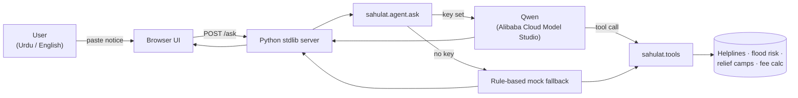

# Sahulat (سہولت) — "Ease", in plain Urdu

An AI assistant that explains confusing bills, court notices, tax notices and flood
alerts in simple Urdu or English — built on **Qwen via Alibaba Cloud Model Studio**,
for the Alibaba Cloud AI Hackathon (Bano Qabil / Alkhidmat Foundation).

**Problem.** Millions of people in Pakistan receive official notices — a disconnection
warning, a court summon, an FBR letter, a flood alert — written in dense bureaucratic
language. Getting it wrong costs money, a missed court date, or a life in a flood.

**Solution.** Paste the notice, ask in Urdu or English, get back: what it means, what to
do next, and the deadline — grounded in deterministic tools, not invented numbers.

## Features

- **Bilingual, tool-grounded answers** — Qwen decides what to say; small Python tools
  decide the *numbers* (late fees, helpline numbers, flood risk), so the model can't
  hallucinate a phone number or a fee.
- **Graceful offline fallback** — with no API key, a rule-based mock mode still
  classifies the document and gives a real answer, so a demo never dies on bad WiFi.
- **One-click examples** — electricity bill, court notice, flood alert (Urdu), tax
  notice — for a reliable, fast live demo.
- **Voice in, voice out** — in-browser speech-to-text input and text-to-speech replies
  (Web Speech API), for low-literacy users.
- **Zero build step** — the whole frontend is one Python stdlib server; no npm, no
  bundler, runs anywhere Python runs.
- **CI** — every push runs the test suite (`.github/workflows/ci.yml`).

## Architecture



## Run it

```bash
pip install -r requirements.txt
export DASHSCOPE_API_KEY=...   # free key from Alibaba Cloud Model Studio; omit for offline mock mode
python app.py                  # http://localhost:8000
python -m pytest tests         # 12 tests, no API key needed
```

## Project layout

```
sahulat/
  agent.py       # Qwen tool-calling loop + deterministic mock fallback
  tools.py        # late-fee calc, helplines, flood risk, relief camps, doc classifier
  demo_data.py    # fictional sample notices for the example chips
app.py             # single-file web UI (stdlib http.server, no build step)
tests/             # pytest, all pass offline
docs/              # screenshots
```

## Honesty notes (what's real vs. illustrative)

- Flood-risk levels and relief-camp lists in `tools.py` are **sample data** for the
  demo — wire them to a live NDMA/PDMA feed before relying on them in an emergency.
- Helpline numbers (Rescue 1122, Edhi 115, etc.) are Pakistan's real public numbers.
- Mock mode is a rule-based fallback, not an LLM — it exists for demo reliability and
  CI, not as a substitute for Qwen.

## Roadmap to a stronger entry

1. Narrow to one user group (e.g. flood-affected families) and tune prompts/tools to them.
2. Add photo upload of a physical notice via Qwen-VL (OCR + explain in one step).
3. Wire flood risk / relief camps to a live NDMA/PDMA data source.
4. Deploy on Alibaba Cloud (ECS/Function Compute) and load-test the demo URL.
5. Pilot with ~20 real users and report a concrete number (e.g. "cut time-to-understand
   a bill from 10 minutes to 30 seconds") in the pitch.

## License

MIT — built as a hackathon starter, adapt freely.
